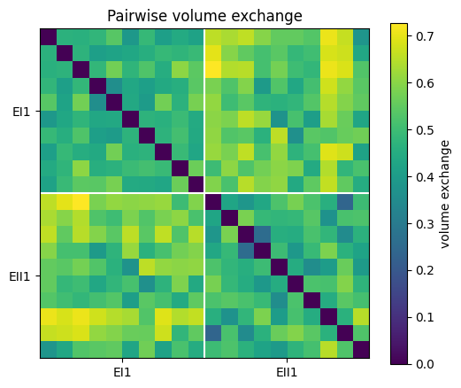
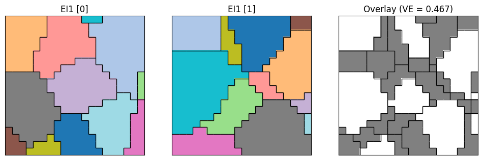
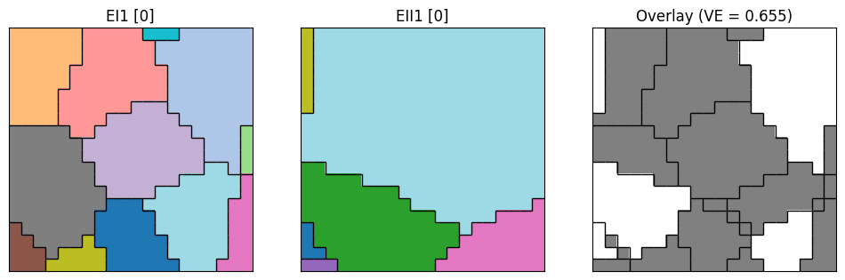

# volume-exchange
Repository containing the implementation of the volume exchange metric and computational experiments.

The **Volume Exchange Metric** is a distance between two grain-labeled microstructure windows `M` and `N`. It finds the one-to-one matching of grains in `M` to grains in `N` that maximizes their total overlapping area, then reports the area left over:

Let $a_{ij}$ represent the overlapping area between a grain $g_i\in M$ and $g_j\in N$. Let $A$ represent the total pixel area of a single window (i.e for $20\times 20$ size windows, $A=400$)
$$
VEM(M, N) = 1 -\frac{1}{A}
\max_{x}\sum_{i,j} a_{ij}\,x_{ij}
\quad \text{s.t.} \quad \sum_j x_{ij} \le 1,\;\; \sum_i x_{ij} \le 1,\;\; x_{ij}\in\{0,1\}

$$

`VEM = 0` means the two windows have identical grain structure, and values closer to `1` mean the two windows have poor optimal matchings.

The constraint $``\sum_j x_{ij} \le 1,\;\; \sum_i x_{ij} \le 1,\;\; x_{ij}\in\{0,1\}"$ ensures mappings between grains are one to one (or mapped to nothing in which case that grain would contribute 0 overlapping area)

## Repository layout

```
volume-exchange/
├── src/
│   └── Volume_Exchange.py           # VolumeExchange metric + helper classes
├── example_data/
│   └── window_dataset.npz           # example grain-labeled windows (~37 MB)
├── notebook_examples/
│   ├── 01_window-reading.ipynb      # load and visualize Windows
│   └── 02_volume-exchange.ipynb     # dissimilarity matrix + matching visualization
└── docs/figures/                    # figures exported from the notebooks
```

## Installation

Requires Python 3 (developed on 3.10) with:

```bash
pip install numpy scipy sympy matplotlib jupyter
```

There is no package install; the notebooks add `src/` to the path directly.

## Example data

`example_data/window_dataset.npz` holds 10 window sets, `EI1, EI2, EII1, EII2, BII1, BII2, RI1, RI2, BI1, BI2`. Each is an array of shape `(1200, 20, 20)`: 1200 windows of 20×20 pixels, where each pixel stores the integer label (as float) of the grain it belongs to.

```python
import numpy as np
data = np.load('example_data/window_dataset.npz')
windows = data['EI1']   # (1200, 20, 20)
```

## Quick start

```python
import sys
sys.path.append('src')
from Volume_Exchange import VolumeExchange

vem = VolumeExchange(data['EI1'][0], data['BI1'][0])

# Also get the overlaid structure and which area was matched
vem, X_img, matched_mask = VolumeExchange(data['EI1'][0], data['BI1'][0], return_overlay=True)
```

## How it works (`src/Volume_Exchange.py`)

1. **Prime relabeling** – `MicrostructureCompute.create_microstructure` gives every grain in both windows its own prime number, drawn from one shared list (primes in `[10, 10000)`), so no two grains in `M` or `N` share a label.
2. **Overlaid structure** – `compute_overlaid_structure` multiplies the two relabeled windows pixel-wise. Because prime factorizations are unique, each product `g_m * g_n` identifies exactly one intersection of a grain from `M` with a grain from `N`. The resulting window `X` has the grain boundaries of both windows.
3. **Cost matrix** – entry `(i, j)` is the negative area fraction of `X` where grain `i` of `M` overlaps grain `j` of `N`. The matrix is zero-padded to be square when the windows have different grain counts.
4. **Optimal matching** – `scipy.optimize.linear_sum_assignment` finds the matching with maximum total overlap, and `VEM = 1 - total overlap`.

With `return_overlay=True`, the function also returns `X_img` and `matched_mask`, a boolean mask of the overlap area of the matched grain pairs (padding pairs excluded). The area of `matched_mask` always equals `1 - VEM`.

## Notebooks

### `02_volume-exchange.ipynb`

**Pairwise dissimilarity matrix.** Picks `n = 10` random windows from each of two classes (`EI1`, `BI1`) and computes the `2n × 2n` volume exchange matrix. The first `n` rows/columns are the first class and the last `n` are the second.



**Matched vs. unmatched grains.** For a pair of windows, the third panel shows the overlaid structure `X` with its grain boundaries. The overlap area of optimally matched grains is white and everything else is gray.

Within-class pair (`EI1` vs `EI1`):



Between-class pair (`EI1` vs `BI1`):




## Notes

- The shared prime list holds about 1,200 primes, so the two windows together can have at most that many grains (the example windows have at most ~31 each).
- `VolumeExchange` loops over every grain pair, so cost grows with `(#grains in M) × (#grains in N) × pixels`. This is fast for 20×20 windows; a full pairwise matrix over many windows grows quadratically in the number of windows.
- Code to compute the energy distance across sweeps (like in the paper) will be available soon.
- Code to compute the the Many-Many Volume Exchange Dissimilarity will also be available soon.
